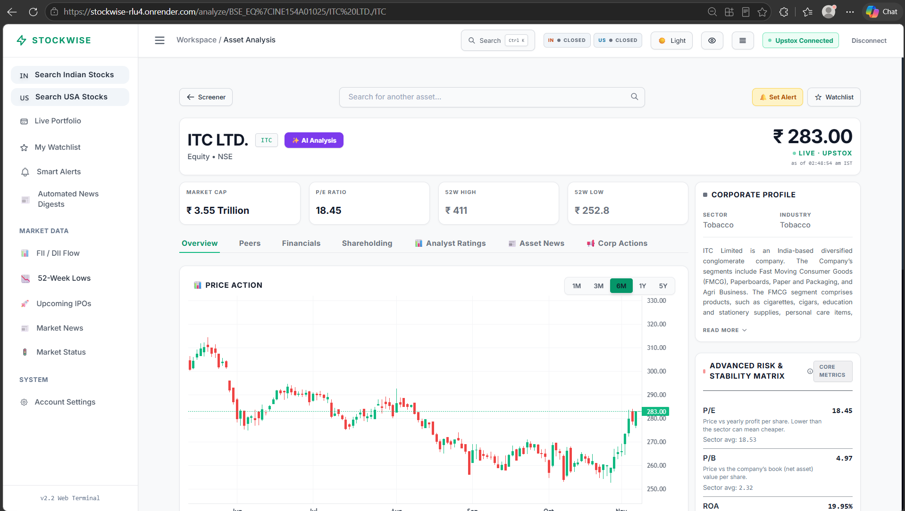
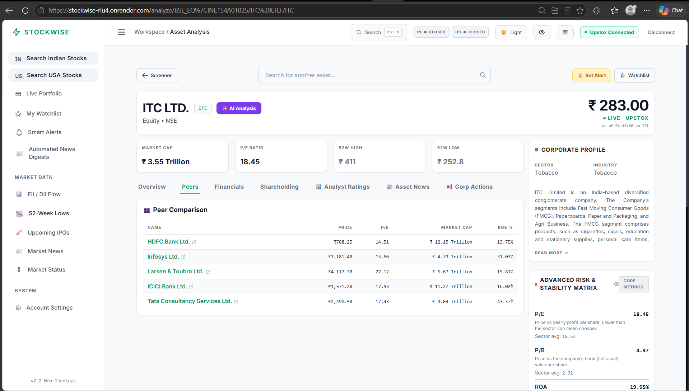
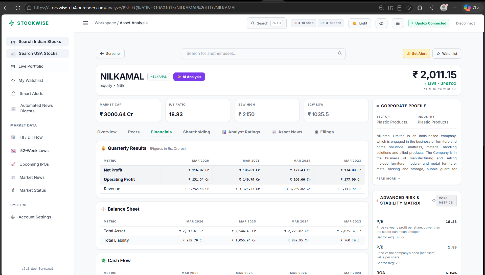
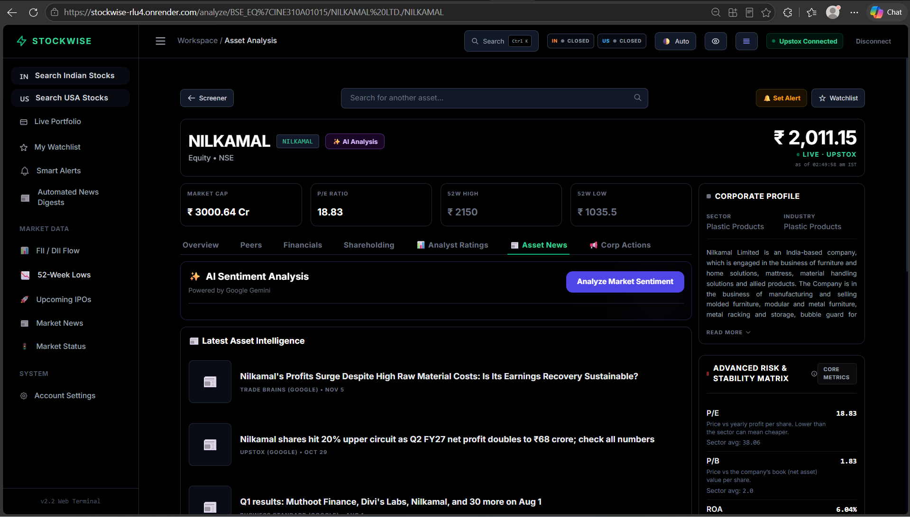
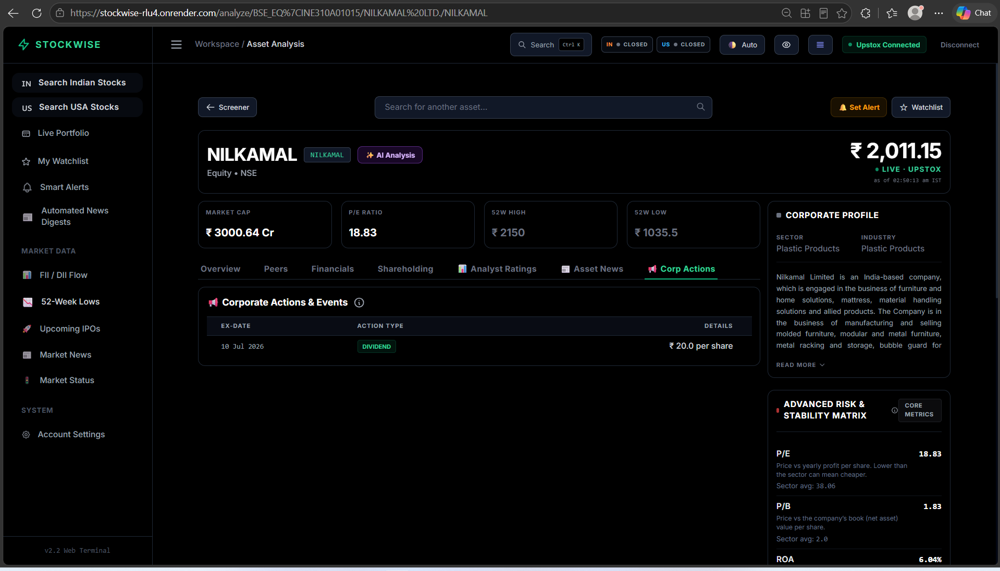
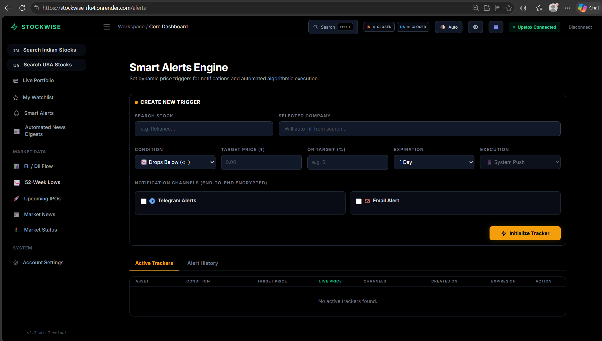
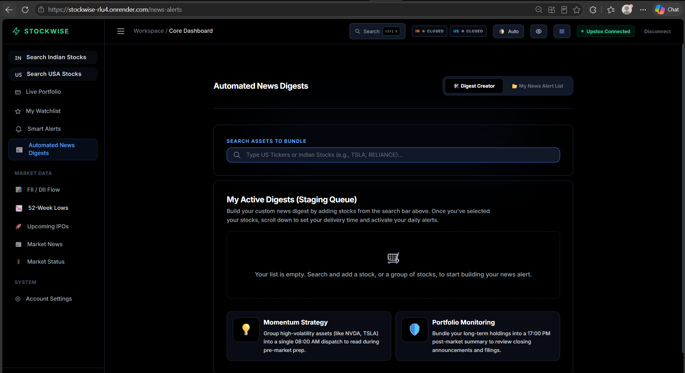
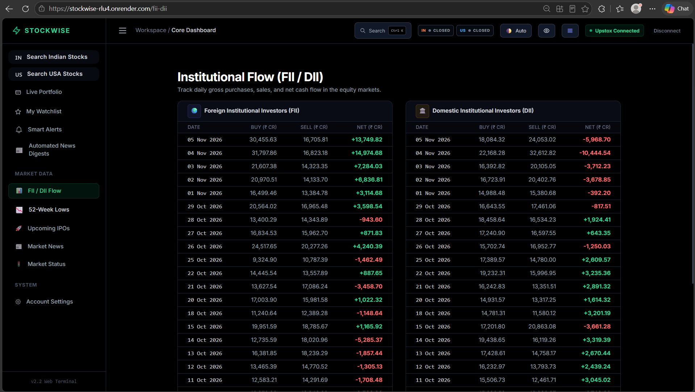

# 📊 StockWise — Invest Smarter

A free, AI-powered market terminal for **Indian (NSE/BSE)** and **US (NYSE/NASDAQ)** equities.
StockWise aggregates live prices, fundamentals, key ratios, peers and news — then uses **Google Gemini** to turn the noise into structured insight: a one-click AI analysis per stock (with current macro context), sentiment scores, portfolio health checks and a daily pre-market email brief.

**▶ Try it live:** https://stockwise-rlu4.onrender.com — US research needs no account; connect your own free Upstox account for full Indian fundamentals. *(Free hosting: the first load after idle can take ~30s.)*

> ⚠️ **Disclaimer:** StockWise is a research/educational tool. AI commentary is synthesized from public data and is **not investment advice**.

> 🔐 **About this repository:** this is the public showcase for StockWise. The application source code is kept in a private repository.

---

## 📸 Tour

### Stock analysis page

Every stock gets one page with live price ("as of" timestamp + source label), KPI cards (market cap, P/E, 52-week range), a candlestick chart (1M–5Y), the corporate profile, and the **Advanced Risk & Stability Matrix** — official key ratios vs the sector average, each with a plain-language explanation. The **✨ AI Analysis** button next to the name reads everything on the page plus current macro headlines and returns a structured verdict; the day's verdict stays pinned as a colored chip.

**Peers tab** — live price, P/E, market cap and ROE for comparable companies, each linked to its own analysis page:

**Financials tab** — yearly results, balance sheet and cash flow (₹ crores) from the official Upstox fundamentals API:

**Asset News tab** — curated headlines per stock, plus the **AI Sentiment Analysis** card (Gemini turns the news into a Bullish/Bearish/Neutral verdict with takeaways):

**Corp Actions / Filings tab** — dividends, splits and bonuses with ex-dates for Indian stocks; SEC filings for US stocks:

Also on this page (not shown): **Shareholding** — promoter/FII/DII/public pattern from exchange disclosures, and **Analyst Ratings** (US stocks) — Wall Street buy/hold/sell consensus.

### Smart Alerts Engine

Price triggers on any stock — absolute targets (`drops below ₹X`) or daily %-moves — with expiry dates, delivered via Telegram and email (contact details encrypted at rest). A triggered alert that fails to deliver stays active and retries.

### Automated News Digests

Bundle any set of stocks into a scheduled daily email — e.g. a pre-market momentum digest at 08:00 or a post-market portfolio summary at 17:00.

### Institutional Flow (FII / DII)

Daily foreign and domestic institutional buy/sell/net cash flows in the Indian equity market.

### And without screenshots…

- **52-Week-Low Screener** — the NSE large/mid-cap 250 basket scanned every 30 minutes for stocks within 5% of their yearly low, with proximity filters, sorting, and one-click alert/watchlist buttons per row
- **My Watchlist** — persistent starred stocks with live batch prices; powers the Morning Brief
- **AI Morning Brief** — one scheduled daily email that condenses news on your whole watchlist into a pre-market read
- **Live Portfolio** — your real Upstox holdings with allocation analytics and an AI health check (requires connecting your own account)
- **Upcoming IPOs / Market News / Market Status** — IPO calendar, aggregated market headlines, and live session status with holiday calendars
- **Telegram bot** — search stocks, download fundamentals reports (PDF/Excel/Word), create alerts and run AI sentiment from chat
- **Ctrl+K command palette, dark/light/auto theming** (auto follows Indian market hours, OLED black overnight), **colorblind-safe mode**, compact density toggle, installable **PWA**

---

## 👤 Who sees what

| | Guest (no login) | Connected (your own free Upstox account) |
|---|---|---|
| US stocks (quotes, charts, KPIs, news, AI) | ✅ full | ✅ full |
| Indian prices, charts, news, 52W screener | ✅ | ✅ |
| Indian fundamentals, ratios, peers, corp actions | — | ✅ |
| Portfolio, alerts, digests, settings | — | ✅ (your account only) |
| AI features | with your Gemini key | with your Gemini key |

Visitors who click **Connect Upstox** authorize with *their own* Upstox account — their token lives only in their browser session. The AI features run on **your own free Gemini key**, added once on the Settings page and stored only in your browser — the server never sees it.

---

## 🏗️ Under the hood

- **Flask + SocketIO** web terminal, background scheduler (alerts every 30s in market hours, digests/brief every minute) and a Telegram bot — all on a single free Render instance
- **Official APIs first**: Upstox for everything Indian (quotes, candles, fundamentals, ratios, corporate actions), Finnhub + Twelve Data for US, Google News RSS for headlines, Google Gemini for AI
- **Supabase (Postgres)** for alerts, digests, watchlist and state that must survive restarts; every price is labeled with its freshness

## 🔒 Security

The codebase is written and reviewed against **HCL AppScan / CodeSweep secure-coding rules** as a standing development standard:

- XSS-safe output encoding for all dynamic and AI-generated content
- Strict input validation on alert and form inputs
- No secrets in source — all credentials live in environment variables
- Contact details (email / Telegram chat IDs) Fernet-encrypted at rest
- Visitor brokerage sessions are isolated; a visitor's login can never touch the owner's background-engine credentials
- Gemini keys never leave the user's browser

---

*Market data belongs to its respective providers. Feedback and feature requests welcome via Issues.*
